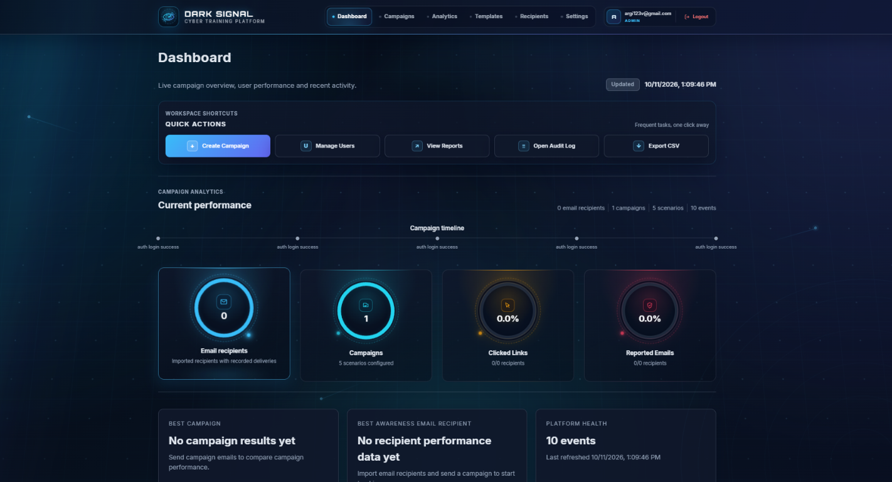
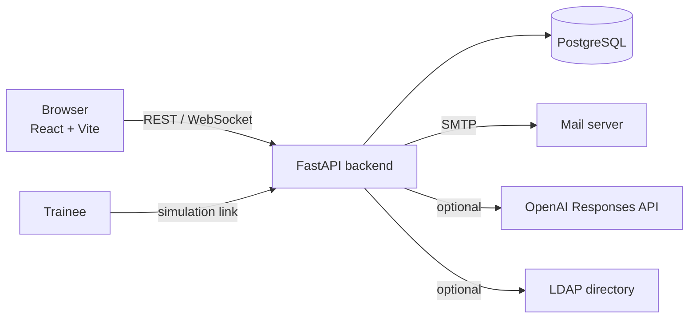

<div align="center">


# DARK SIGNAL

**Cyber Training Platform**

[](https://github.com/argirisviv/dark-signal/actions/workflows/ci.yml)


**A multi-tenant phishing awareness simulator that measures human risk and turns it into targeted training.**

</div>



---

## Overview

**Dark Signal** lets security teams run **safe, consented phishing simulations**, track how people respond, and automatically follow up with adaptive training. It was built as an educational cybersecurity platform and thesis project, with an emphasis on secure defaults, auditability and ethics.

No real malicious content is ever sent: every campaign is a simulation and every "phishing" link leads to an educational feedback page.

## Features

| Area | Capabilities |
|---|---|
| **Campaigns & scenarios** | Campaigns with one or more phishing scenarios, scheduling, lifecycle management, per-campaign recipient snapshots |
| **Email templates** | Template catalog and editor, server-side HTML sanitization, sandboxed previews, optional AI template assistant (OpenAI) |
| **Analytics** | Click / report / submit rates, department and risk breakdowns, risk trends per user, interactive geo map |
| **Adaptive training** | Training catalog, automatic assignments and adaptive programs driven by user behavior |
| **Access control** | Role-based access (Admin, Analyst, Viewer, Trainee), JWT sessions with automatic expiry handling |
| **Multi-tenancy** | Tenant-isolated data and settings, optional directory (LDAP) integration |
| **Operations** | Operational alerts with acknowledgements, audit log, PDF export, real-time updates over WebSocket |
| **Security** | One-time bootstrap token for the first admin, last-admin protection, secrets only via environment variables |

## Architecture



```
.
├── backend/     FastAPI app, SQLAlchemy models, Alembic migrations, pytest suite
├── frontend/    React + Vite single-page application
├── docs/        Threat model, ethics & consent, evaluation metrics, MITRE mapping
├── .github/     CI workflow (migrations, tests, lint, build, audit)
└── docker-compose.yml
```

## Tech stack

- **Backend:** Python 3.12, FastAPI, SQLAlchemy, Alembic, Pydantic, JWT (python-jose), ReportLab
- **Frontend:** React 18, Vite, Chart.js, Leaflet
- **Data:** PostgreSQL 16
- **Tooling:** Docker Compose, GitHub Actions, pytest, ESLint

## Getting started

### Option 1 - Docker (recommended)

```bash
git clone https://github.com/argirisviv/dark-signal.git
cd dark-signal
cp .env.example .env        # Windows: Copy-Item .env.example .env
```

Generate a different random value for `POSTGRES_PASSWORD`, `SECRET_KEY` and `BOOTSTRAP_TOKEN`:

```bash
python -c "import secrets; print(secrets.token_urlsafe(64))"
```

Paste them into `.env`, then:

```bash
docker compose up --build
```

| Service | URL |
|---|---|
| Frontend | http://localhost:3000 |
| Backend API | http://localhost:8000 |
| API docs (Swagger) | http://localhost:8000/docs |
| Health check | http://localhost:8000/health |

Migrations run automatically on backend start. Use the bootstrap token to create the first administrator.

### Option 2 - Local development

```bash
# Backend
python -m venv .venv
.venv\Scripts\activate                 # Linux/macOS: source .venv/bin/activate
pip install -r backend/requirements.txt
cd backend
uvicorn app.main:app --reload --port 8000

# Frontend (new terminal)
cd frontend
npm install
npm run dev                            # http://localhost:3000
```

On Windows you can also use `start-all.bat`. See [SETUP.md](SETUP.md) for the detailed (Greek) walkthrough.

## Configuration

All configuration is done through environment variables; see [`.env.example`](.env.example).

| Variable | Required | Purpose |
|---|---|---|
| `POSTGRES_*` | yes | Database name, user and password |
| `SECRET_KEY` | yes | Signs access tokens |
| `BOOTSTRAP_TOKEN` | yes | Creates the first administrator only |
| `OPENAI_API_KEY` | no | Enables the AI template assistant (never exposed to the frontend) |
| `SMTP_*` | no | Password-reset and simulation email delivery |

## Testing

```bash
cd backend && python -m pytest tests -q     # backend tests
cd frontend && npm run lint && npm run build
```

Both run on every push and pull request via [GitHub Actions](.github/workflows/ci.yml).

## Deployment

The frontend can be deployed as a static site (see [frontend/DEPLOY_NETLIFY.md](frontend/DEPLOY_NETLIFY.md)) by setting `VITE_API_BASE_URL` to the public backend URL. The backend is deployed separately (Docker image provided).

## Security & ethics

Phishing simulation is only appropriate with proper authorization. Read the documentation before running a campaign:

- [Ethics and consent](docs/ethics-and-consent.md)
- [Threat model](docs/threat-model.md)
- [Evaluation metrics](docs/evaluation-metrics.md)
- [MITRE ATT&CK mapping](docs/mitre-mapping.md)

Never commit real credentials. `.env` is git-ignored.

## Documentation

A full project report is available in [Dark-Signal-Documentation.pdf](docs/Dark-Signal-Documentation.pdf).

## Disclaimer

Dark Signal is intended for **authorized security awareness training and education only**. Use it only on people and systems you are permitted to test.


